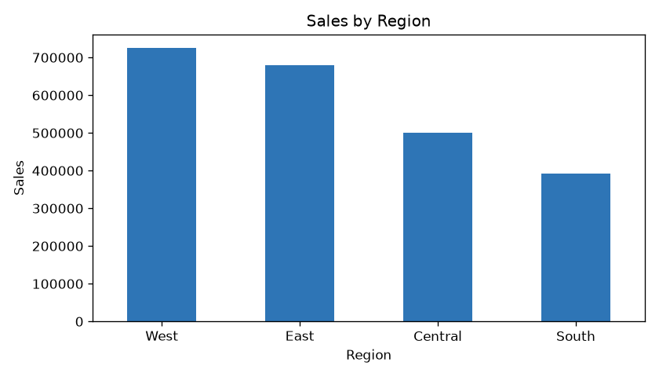
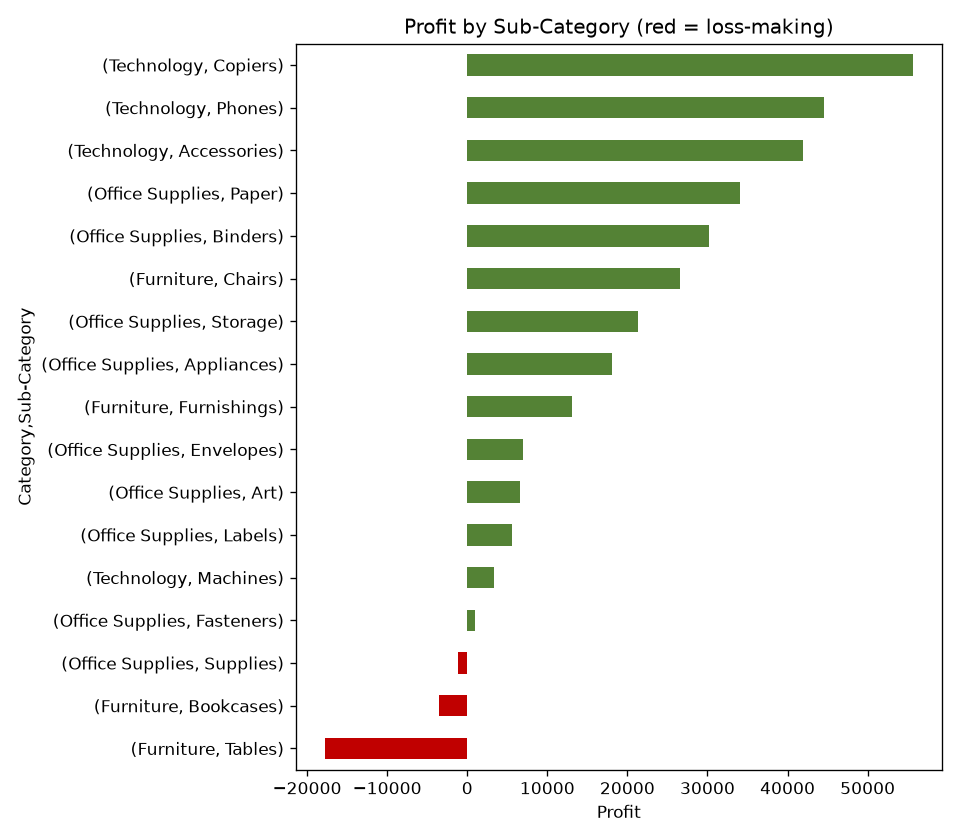
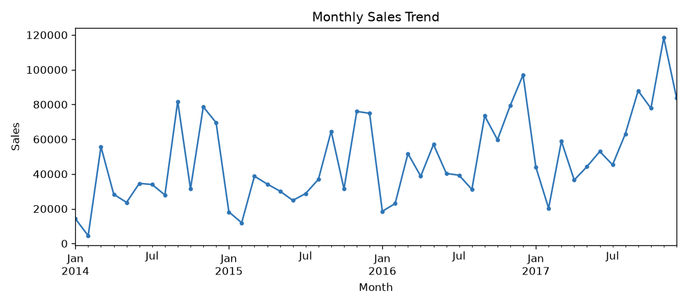
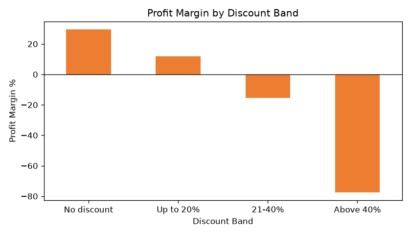

# Sales Performance & Territory Analysis

Python analysis of retail sales data to find which regions, categories and products drive revenue, and where profit is being lost through discounting.

**Tools:** Python, pandas, matplotlib
**Dataset:** [Superstore Sales Dataset (Kaggle)](https://www.kaggle.com/) - file `Sample - Superstore.csv`

## Business Questions
1. Which regions (territories) generate the most sales and profit?
2. Which product sub-categories make or lose money?
3. How do sales change month to month (seasonality)?
4. How do discounts affect profit margin?
5. Which states are loss-making?

## How to Run
```bash
pip install pandas matplotlib
python analysis.py
```
Place `Sample - Superstore.csv` in the same folder. Charts are saved to `charts/`.

## Key Findings
*(Replace the X values with numbers from your own output after running the script.)*

- **Top region:** X leads in sales (X) with a profit margin of X%. X has the lowest margin at X%.
- **Loss-making products:** X and X sub-categories are loss-making despite healthy sales.
- **Discounts hurt profit:** Orders with discounts above 40% have a negative margin of X%, while undiscounted orders earn X%.
- **Seasonality:** Sales peak in months X and X (Q4 is typically strongest).
- **Weak states:** X, X and X are the biggest loss-making states.

## Recommendations
1. Focus sales effort and distribution on the highest-margin regions; review pricing in the weakest region.
2. Cap discounts at 20-30% and review the loss-making sub-categories.
3. Plan stock and promotions ahead of the peak months.
4. Audit loss-making states for pricing, shipping cost and discount practices.

## Charts





## Project Structure
```
sales-territory-analysis/
├── analysis.py
├── Sample - Superstore.csv
├── charts/
└── README.md
```
